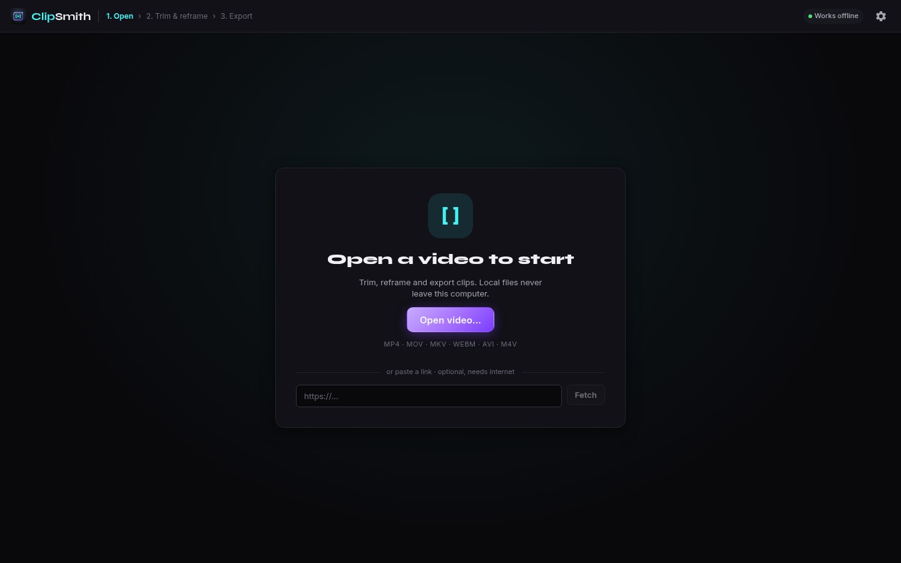
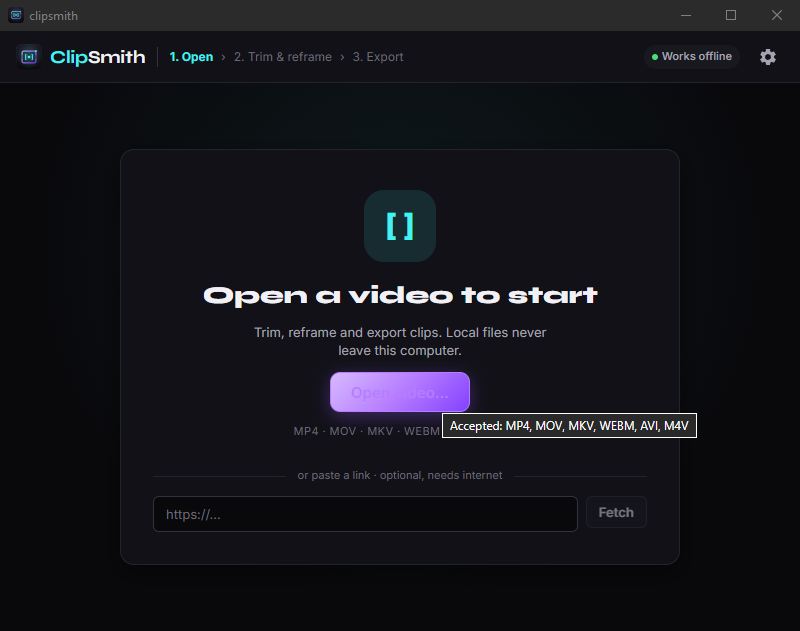
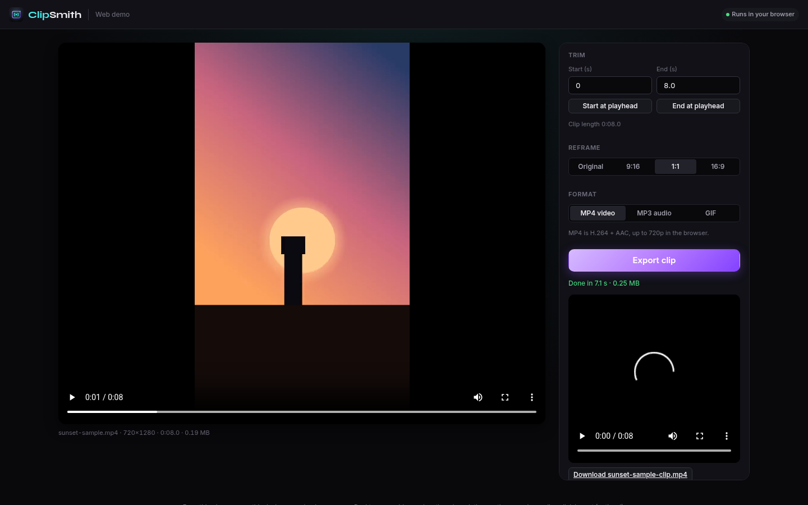

<p align="center">
  
</p>

<h1 align="center">ClipSmith</h1>

<p align="center">Trim, reframe and export clips from any local video. Frame-accurate, fully offline.</p>

<p align="center">
  <a href="https://github.com/ccharafeddine/ClipSmith/releases/latest"></a>
  <a href="https://github.com/ccharafeddine/ClipSmith/actions/workflows/ci.yml"></a>
  <a href="https://github.com/ccharafeddine/ClipSmith/releases"></a>
  <a href="LICENSE"></a>
  
  
</p>

---

ClipSmith is a small, fast desktop app for Mac and Windows. Open a local video
(or paste a URL — YouTube and other sites work), scrub a timeline to pick start
and end points, optionally **reframe** the picture to a new aspect ratio, choose
an output **format**, and export a trimmed clip. The cut is **frame-accurate**:
ClipSmith re-encodes the selected range with H.264 so the IN and OUT points land
exactly where you put them — no snapping to keyframes. It's local-first: no
accounts, no media library, no telemetry, no ads. A local video is read in place
and never imported or copied. The only feature that touches the network is URL
import, which downloads the video to a temp file (deleted when you quit); the
only file kept on disk is the clip you export.

Built with [Tauri](https://v2.tauri.app) and [SolidJS](https://www.solidjs.com),
with a bundled GPL build of [FFmpeg](https://ffmpeg.org) (`libx264`, plus `libvpx`
and `libopus` for WebM) for probing, thumbnails, and the export.

<p align="center">
  
</p>
<p align="center">
  
</p>

## Works offline

Every feature has a local path. You never need an internet connection or an account.

- Opening, trimming, reframing (including auto-reframe; its ONNX models are bundled) and exporting all run locally with the bundled FFmpeg.
- Link import is optional and is the only feature that uses the network. The empty state labels it "optional, needs internet".
- Fonts (Inter, Syne) and icons ship inside the app. Nothing loads from a CDN.

## Web demo

A browser version lives in the [MediaSmith repo](https://github.com/ccharafeddine/media-smith) (branch `design/v2-impl` until it is merged) under
`apps/smiths-web` (page `clip.html`). It runs on ffmpeg.wasm with local files only: no
server and no uploads. In the browser you can open or drop a local file, trim (typed or from the playhead), reframe (original, 9:16, 1:1 or 16:9 centre crop) and export MP4 (H.264 + AAC, up to 720p), MP3 or GIF. Only the desktop app has
link import, auto-reframe, hardware encoders, any length or resolution. See MediaSmith `docs/web.md` for the build and hosting notes.

<p align="center">
  
</p>

## How export works

ClipSmith re-encodes the selected range and mixes the frame down to your chosen
canvas and format. Because every frame is decoded and re-encoded, the start and
end points are exact to the frame — drag the handles anywhere, no keyframe
snapping, no dead zones you can't trim through. Any **reframe** (blur-fill, pad,
or crop) is applied in the same pass.

For the H.264 formats the **Quality** control ranges from **High** (CRF 18,
`preset medium`, visually near-lossless) down to **Draft** (fast and small), and
a **Resolution** control can cap the output (Source / 1080p / 720p / 480p). The
encode runs on `libx264` or a **hardware encoder** if you have one (see below).
The trade-off versus a pure stream copy is that the export is not instant and not
bit-identical to the source; a progress bar shows while it encodes, and a success
state lets you reveal the file in Finder / Explorer.

MP4 is the default. The first video stream and all audio are kept; subtitles and
attachments are not carried into the re-encoded file.

**Lossless mode.** If you don't need frame-accurate cuts, reframing, or a format
change, switch the export **Mode** to **Lossless**: ClipSmith stream-copies
(`-c copy`) instead of re-encoding, so the export is near-instant and
bit-identical to the source and keeps its original format and all streams. A
stream copy can only begin on a keyframe, so the trim start snaps to the nearest
keyframe (shown as ticks on the timeline).

## Reframe

Cropping used to just throw pixels away. In ClipSmith the target ratio is an
output **canvas**, and you choose how the source fills it:

- **Blur-fill** — fit the whole frame inside the canvas and fill the leftover
  bars with a blurred, zoomed copy of the video. Nothing is cropped away.
- **Pad** — the same fit, but solid-color bars (your color, default black).
- **Crop-to-fill** — scale up and crop to the canvas, either a **manual**
  aspect-locked box you drag, or **Auto-Reframe (subject)**.

Canvas presets are **9:16, 1:1, 4:5, 16:9**, plus **Original** (the source ratio)
and **Freeform** (an unconstrained crop that exports at the box's size). For
blur-fill and pad you can position the frame (top/center/bottom or
left/center/right). The result previews live on the player before you export.

### Auto-Reframe (subject tracking)

Crop-to-fill can follow the action for you. **Auto-Reframe** analyzes the clip
once for **faces and people** — in-process, with the pure-Rust
[`tract`](https://github.com/sonos/tract) engine running bundled ONNX detectors,
so nothing leaves your machine — then pans the crop to keep the subject in shot:
smoothly within a shot, cutting cleanly at scene changes. Changing the canvas
ratio re-derives the pan instantly without re-analyzing. A moving box on the
preview shows exactly what the export will do.

Automatic tracking is best on ordinary footage (real people); it can lose a
stylized or low-contrast subject. So when a moment isn't framed right, **drag the
crop box on the video to fix it** — the pan passes through your correction and
eases back to the automatic track on either side. Each fix drops a marker on the
timeline (click to remove); corrections are baked into the export.

## Output formats

ClipSmith exports **MP4** by default but can also write **MOV**, **MKV**
(H.264 / AAC), or **WebM** (VP9 / Opus) — so it doubles as a container/codec
converter. WebM appears when the bundled FFmpeg can produce it (both the Windows
and macOS builds ship VP9 + Opus).

## Hardware encoders

For the H.264 formats, ClipSmith can use your machine's hardware encoder — **Apple
VideoToolbox** on macOS, **NVENC / Quick Sync / AMF** on Windows — for a much
faster export at comparable quality. It's detected at runtime with a tiny
test-encode and falls back cleanly to **libx264** software encoding if no usable
hardware is found. An **Auto / Software** toggle lets you force software.

## Features

- Open `mp4`, `mov`, `mkv`, `webm`, `avi`, `m4v` via file picker
- **Import from a URL** (desktop app): paste a link and ClipSmith fetches it
  with the shared smith-fetch engine: a bundled [yt-dlp](https://github.com/yt-dlp/yt-dlp)
  that keeps itself up to date (checksum-verified, with an update-and-retry when a
  site changes), plain HTTP for direct video files, HLS/DASH manifests, and a page
  scraper for generic players. *Quality & options…* offers a format picker,
  opt-in playlists (max 50) and live recording with Stop. *Browse page…* opens the
  page in a built-in window and lists the videos it plays. Sites that need a login
  get *Sign in to this site…*; Settings → Downloads covers browser cookies,
  cookies.txt import, saved sign-ins, updates and an off-by-default clipboard watcher.
  DRM-protected video is detected and never saved.

  **Legal:** only download videos you have the right to save (your own, openly
  licensed, or with the owner's permission) and respect each site's terms of
  service. ClipSmith does not circumvent DRM.
- A timeline with **filmstrip thumbnails** and iOS-style trim handles,
  **zoomable** (scroll to zoom, cursor-anchored). **Both handles are free and
  frame-accurate** — drop them wherever you want.
- **Reframe** to a new aspect ratio (blur-fill / pad / crop-to-fill, plus
  Original and Freeform), with source positioning and a live preview
- **Auto-Reframe** — subject tracking that pans the crop to follow faces/people
  (in-process ONNX detection, nothing leaves your machine), with **drag-to-fix**
  manual corrections when a moment needs it
- **Output format** picker (MP4 / MOV / MKV / WebM) — a built-in converter
- **Hardware-accelerated H.264 export** with a libx264 fallback, or plain
  software encoding; a real progress bar and a reveal-in-folder success state
- Exports default to an **Exports folder** (`<Documents>/ClipSmith/Exports`),
  created on first export — the save dialog opens there with the name prefilled,
  and you can still save anywhere
- Looping playback between the trim handles, with the audio kept intact (the
  player doubles as the preview)
- **Audio controls** — mute the clip or set its volume (0–200%); the preview
  reflects both as you tweak them
- **Settings + in-app update check** against GitHub Releases (prompt-only, never
  a silent install) with an optional check on startup
- **Clear** the loaded video without opening another
- Dark, minimal interface that fits the window without scrolling
- Native binaries for macOS and Windows

## Keyboard shortcuts

| Key | Action |
|---|---|
| `Space` | Play / pause |
| `←` / `→` | Step one source frame |
| `I` | Set the clip start (IN) at the playhead |
| `O` | Set the clip end (OUT) at the playhead |
| Scroll over the timeline | Zoom in / out (cursor-anchored) |

## Install

Download the latest installer from the
[Releases](https://github.com/ccharafeddine/ClipSmith/releases) page:

- **Windows**: the `.msi` (or `.exe` setup). Windows SmartScreen may warn on an
  unsigned app; choose **More info → Run anyway**.
- **macOS**: the `.dmg` (one universal build runs on both Apple Silicon and
  Intel). The app is unsigned, so the first launch needs the Gatekeeper
  workaround:

  > **Right-click** (or Control-click) the app in Applications → **Open** →
  > **Open** again in the dialog. You only need to do this once.

## Build from source

Prerequisites: [Node.js](https://nodejs.org) 20+ and the
[Rust toolchain](https://rustup.rs).

```bash
npm install

# Provide the bundled FFmpeg/ffprobe sidecars, placed in src-tauri/binaries
# with the per-target-triple names Tauri expects.
bash scripts/fetch-ffmpeg.sh        # Windows: BtbN GPL static build
                                    # (libx264 + libvpx + libopus)
bash scripts/build-ffmpeg-macos.sh  # macOS: compile GPL FFmpeg from source with
                                    # static libx264 + libvpx + libopus
                                    # (needs Xcode CLT + `brew install nasm`)

# Provide the bundled yt-dlp sidecar for URL import (refresh before each release;
# yt-dlp goes stale as sites change their players).
bash scripts/fetch-ytdlp.sh

# Provide the bundled ONNX detector models for subject-aware auto-reframe
# (Ultraface + NanoDet-Plus, run in-process with pure-Rust tract).
bash scripts/fetch-models.sh

# Run in development
npm run tauri dev

# Produce a production build for the current platform
npm run tauri build

# Checks (also run in CI)
npm run typecheck && npm test              # frontend
cd src-tauri && cargo fmt --all -- --check && cargo clippy --all-targets -- -D warnings && cargo test
```

On macOS there's no suitable static GPL FFmpeg, so the sidecars are compiled from
source with `--enable-gpl --enable-libx264 --enable-libvpx --enable-libopus`
against statically built libraries; on a Mac, `bash scripts/fetch-ffmpeg.sh`
delegates to the build script for you. CI runs the checks on every push
(`.github/workflows/ci.yml`) and builds both platforms on a tag push
(`.github/workflows/release.yml`).

## Bundled binaries & licensing

ClipSmith is **GPL-3.0** licensed. It re-encodes with `libx264`, which is GPL;
combining it makes the whole app GPL (the standard situation for open-source
video tools like HandBrake, Shotcut, and OBS). The binaries it bundles are
invoked as separate sidecar processes:

- **FFmpeg** (GPL, with `libx264`), used for probing, timeline thumbnails, and the
  re-encode. It also links `libvpx` (VP9) and `libopus` (both BSD-licensed) for
  WebM. Windows uses the GPL static build from
  [BtbN/FFmpeg-Builds](https://github.com/BtbN/FFmpeg-Builds); macOS is compiled
  from the official [FFmpeg](https://ffmpeg.org/download.html) source. Source:
  <https://ffmpeg.org/download.html>.
- **yt-dlp** (Unlicense / public domain), used only for URL import. Bundled as a
  sidecar and refreshed per release via `scripts/fetch-ytdlp.sh`. Source:
  <https://github.com/yt-dlp/yt-dlp>.
- **ONNX detector models** for subject-aware auto-reframe, run in-process with the
  pure-Rust [`tract`](https://github.com/sonos/tract) engine (MIT/Apache-2.0):
  [Ultraface](https://github.com/onnx/models) face detector (MIT) and
  [NanoDet-Plus](https://github.com/RangiLyu/nanodet) person detector
  (Apache-2.0). Fetched by `scripts/fetch-models.sh` and bundled as app resources.
- **Font**: Syne (SIL Open Font License), bundled in `src/assets/fonts` with its
  license file. No web-font requests are made.

## Roadmap

Shipped in v1.0.0: frame-accurate cutting, **reframe**, format conversion, and
hardware encoders. **v2** builds on reframe and is fully landed:

1. ✅ **Settings + auto-update** — a settings panel with an in-app update check
   against GitHub Releases (prompt-only, never a silent install).
2. ✅ **Export-quality presets** — a **Quality** tier (Draft / Balanced / High)
   and a **Resolution** cap (Source / 1080p / 720p / 480p), replacing the fixed
   CRF 18 / `medium`.
3. ✅ **Lossless fast-path** — an opt-in **Lossless** export mode that
   stream-copies (`-c copy`): instant and bit-identical, keeping the source
   format, snapping the trim start to a keyframe (no reframe or re-encode).
4. ✅ **Audio controls** — **Mute** and a per-clip **Volume** (0–200%) on the
   export, mirrored live in the preview.
5. ✅ **Subject-aware auto-reframe** — track faces/people and pan the crop to
   keep the subject in shot, with drag-to-fix manual corrections.

On the horizon: code-signing + notarization, done across the app suite.
Concatenation is no longer a ClipSmith feature — it moved to a separate app,
**ClipWeaver**.

## License

[GPL-3.0](LICENSE) © Chafic Charafeddine. Bundled FFmpeg is GPL (with `libx264`),
as noted above.

## Release notes

### v2.2.0

The v2 design release. ClipSmith now matches the rest of the Smith suite. Grab the
installers from the [v2.2.0 release](https://github.com/ccharafeddine/ClipSmith/releases/tag/v2.2.0).

- **New look:** the Smith v2 design system with the Inter font and a new logo
  and icons. The top bar shows the Open, Trim and Export steps, and a
  "Works offline" chip.
- **Clearer start screen:** "Open video…" comes first, and link import is
  labelled optional, since local files never need the internet.
- **Clearer link-import errors:** common yt-dlp failures (private, region-locked
  or removed videos) now get plain-language messages.
- **Try it in a browser:** a web demo (trim, reframe and export MP4, MP3 or GIF
  with ffmpeg.wasm) lives in the MediaSmith repo under `apps/smiths-web`.

### v2.0.0

The reframe release. ClipSmith learned to **follow the action**, gained export
controls, and picked up settings + updates. Grab the installers from the
[v2.0.0 release](https://github.com/ccharafeddine/ClipSmith/releases/tag/v2.0.0).

- **Auto-Reframe (subject tracking)** — crop-to-fill can detect faces and people
  (in-process, pure-Rust ONNX inference — nothing leaves your machine) and pan
  the crop to keep the subject in shot, smoothing within a shot and cutting at
  scene changes. When automatic tracking misses a moment, **drag the crop box to
  fix it** and the pan eases back to auto; fixes show as timeline markers and are
  baked into the export. (Automatic tracking is strongest on ordinary real-people
  footage.)
- **Export-quality presets** — a **Quality** tier (Draft / Balanced / High) and a
  **Resolution** cap (Source / 1080p / 720p / 480p).
- **Lossless mode** — an opt-in `-c copy` export: instant, bit-identical, keeps
  the source format and all streams (keyframe-snapped trim, no reframe).
- **Audio controls** — **Mute** and a per-clip **Volume** (0–200%), mirrored in
  the preview.
- **Settings + in-app update check** against GitHub Releases (prompt-only), with
  an optional check on startup.

### v1.0.0

The big one. Cropping grew into full **Reframe**, ClipSmith became a format
converter, and exports can use your GPU. Grab the installers from the
[v1.0.0 release](https://github.com/ccharafeddine/ClipSmith/releases/tag/v1.0.0).

- **Reframe** — the target aspect is now an output *canvas*, and you choose how
  the source fills it:
  - **Blur-fill** (blurred, zoomed copy fills the bars), **Pad** (solid color
    bars, your pick), **Crop-to-fill** (manual, aspect-locked box), plus
    **Original** and a **Freeform** crop.
  - Canvas presets **9:16 / 1:1 / 4:5 / 16:9**, with source positioning
    (top/center/bottom or left/center/right) and a live preview on the player.
- **Output format picker** — export **MP4**, **MOV**, **MKV** (H.264/AAC) or
  **WebM** (VP9/Opus). ClipSmith now doubles as a container/codec converter.
- **Hardware encoders** — Apple VideoToolbox (macOS) and NVENC / Quick Sync / AMF
  (Windows), detected at runtime with a clean **libx264 software fallback**, via
  an Auto / Software toggle. Comparable quality, much faster where available.
- **Redesigned editor** — a two-column layout that fits the window without
  scrolling (preview + timeline on the left, all export settings on the right),
  `?` tooltips, and an export **success state** with reveal-in-folder.
- **Hardening** — a security + logic audit added guards around URL import,
  filtergraph building, path/filename handling, and download size, plus a CI
  pipeline (fmt / clippy / tests, frontend type-check / tests / build) and Rust +
  frontend test suites.

### v0.1.0

Initial release: frame-accurate H.264 / AAC `.mp4` cut with an optional crop, a
zoomable timeline with filmstrip thumbnails and free trim handles, URL import via
a bundled yt-dlp, and an automatic playback proxy for codecs the webview can't
decode. (This is where the `libx264` re-encode relicensed the app to GPL-3.0.)

## Web demo

A standalone static build for https://clip.chafic.me/ is in [`web/dist/`](web/dist). See [`web/README.md`](web/README.md) for the required headers and how to rebuild it.
